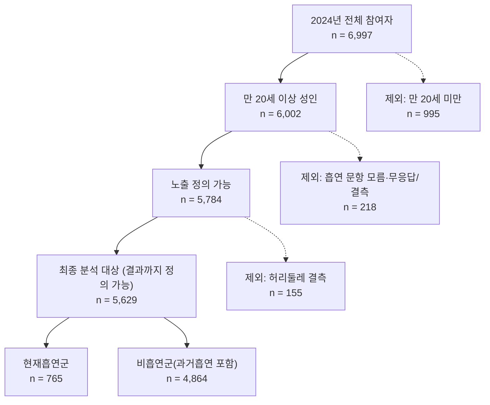

# 10주차 과제: 분석 대상 선정과 Table 1 (4팀: 현재흡연 → 복부비만)

* **자료:** 국민건강영양조사 제9기 3차년도(2024), 원시자료 `hn24.sav` (6,997행)
* **기준:** `docs/09_protocol.md` (9주차 검토의견 반영 수정본). 모든 숫자는 `code/10_table1.ipynb`의 출력에서 가져왔다.
* **연구질문:** 만 20세 이상 성인에서 현재흡연군과 비흡연군의 복부비만 유병률을 비교한다.

---

## B-1. 대상자 흐름도

행을 지우지 않고 분석 대상 표시변수 `in_analysis = 1`을 만들어 도메인으로 다룬다. 원자료 6,997행, 층·집락 구조는 그대로 유지하며 층 27개, 집락 192개이다.

| 단계 | 기준 | 남은 인원 | 제외 인원 | 제외 이유 |
| :--- | :--- | ---: | ---: | :--- |
| 1 | 2024년 전체 참여자 | 6,997 | - | - |
| 2 | 만 20세 이상 성인 (`age` ≥ 20) | 6,002 | 995 | 만 20세 미만 |
| 3 | 노출 정의 가능 (`BS3_1` = 1, 2, 3, 8) | 5,784 | 218 | `BS3_1` = 9(모름·무응답) 216명, 결측 2명 |
| 4 | 결과 정의 가능 (`HE_wc` 있음) = **최종 분석 대상** | **5,629** | 155 | 허리둘레 결측 (성인 결측 172명 중 17명은 3단계에서 이미 제외) |

* **최종 분석 대상 5,629명 = 현재흡연군 765명 + 비흡연군(과거흡연자 포함) 4,864명**
* 현재흡연군은 남성 636명, 여성 129명이고 비흡연군은 남성 1,774명, 여성 3,090명이다.
* 공변량 결측(`incm`, `edu`, `pa_aerobic`)은 대상에서 빼지 않고 Table 1에 결측 수로 적었다.
* **9주차와 달라진 점:** 없음. 단계별 인원이 9주차 프로토콜과 모두 같다.

---

## B-2. Table 1

**Table 1. 현재흡연 여부에 따른 2024년 성인의 일반적 특성 (국민건강영양조사 제9기 3차년도)**

| 변수 | 전체 (n = 5,629) | 현재흡연군 (n = 765) | 비흡연군(과거흡연 포함) (n = 4,864) |
| :--- | ---: | ---: | ---: |
| 복부비만 (남 ≥90cm, 여 ≥85cm) |  |  |  |
| 　예 | 2,026 (35.5) | 306 (40.3) | 1,720 (34.6) |
| 허리둘레, cm — 평균 (SE) | 84.0 (0.21) | 87.4 (0.42) | 83.4 (0.21) |
| 성별 |  |  |  |
| 　남자 | 2,410 (50.0) | 636 (87.3) | 1,774 (42.9) |
| 　여자 | 3,219 (50.0) | 129 (12.7) | 3,090 (57.1) |
| 연령, 세 (80은 '80세 이상') — 평균 (SE) | 49.8 (0.47) | 47.2 (0.69) | 50.3 (0.50) |
| 소득 4분위수(개인) |  |  |  |
| 　하 | 1,383 (24.2) | 234 (28.1) | 1,149 (23.5) |
| 　중하 | 1,407 (25.1) | 191 (26.7) | 1,216 (24.8) |
| 　중상 | 1,413 (25.4) | 177 (24.3) | 1,236 (25.6) |
| 　상 | 1,410 (25.3) | 161 (20.9) | 1,249 (26.1) |
| 　결측 | 16 | 2 | 14 |
| 교육수준 |  |  |  |
| 　초졸 이하 | 934 (11.5) | 67 (5.8) | 867 (12.6) |
| 　중졸 | 584 (8.1) | 87 (9.0) | 497 (7.9) |
| 　고졸 | 1,845 (34.0) | 325 (42.9) | 1,520 (32.3) |
| 　대졸 이상 | 2,260 (46.5) | 284 (42.4) | 1,976 (47.2) |
| 　결측 | 6 | 2 | 4 |
| 최근 1년 음주 (BD1_11 2~6) |  |  |  |
| 　음주 | 3,981 (75.3) | 659 (88.9) | 3,322 (72.7) |
| 　비음주 | 1,648 (24.7) | 106 (11.1) | 1,542 (27.3) |
| 유산소 신체활동 실천 |  |  |  |
| 　실천 | 2,313 (47.3) | 306 (46.7) | 2,007 (47.4) |
| 　미실천 | 2,962 (52.7) | 414 (53.3) | 2,548 (52.6) |
| 　결측 | 354 | 45 | 309 |

**각주**

a. n은 비가중 관측 수이고, %와 평균은 가중 추정치이다. SE는 설계 기반(층·집락 반영)이다. 범주형 변수의 %는 결측을 뺀 응답자 기준이며 범주별 %의 합은 100%이다.
b. 연속형 변수(허리둘레, 연령)는 히스토그램이 한쪽으로 크게 치우치지 않고 왜도의 절댓값이 모두 1보다 작아(허리둘레 0.34, 연령 -0.27; 군별로도 -0.31~0.39) 가중 평균(SE)으로 요약했다. 연령 80은 "80세 이상" 상한 코드(탑코딩)이다.
c. 가중치는 `wt_itvex`(건강설문-검진조사 가중치), 층은 `kstrata`, 집락은 `psu`이다. 분석 대상 표시변수 `in_analysis`와 흡연군의 곱을 도메인으로 하는 도메인 분석을 했고(행 삭제 없음), 분산은 층·집락 선형화로 추정했다.
d. 복부비만은 남성 허리둘레 ≥ 90cm, 여성 ≥ 85cm이다. 흡연 `BS3_1` = 8(비해당)은 평생 비흡연자로 비흡연군에 넣었고, 9(모름·무응답)와 결측은 노출을 정의할 수 없어 대상에서 제외했다. 음주 `BD1_11` = 8(비해당, `BD1` = 1과 일치)은 비음주로 분류했고 9·결측은 결측으로 두었다. 공변량 결측은 대상에서 빼지 않고 해당 변수의 분모에서만 제외했다. 결측 비율은 `incm` 0.3%, `edu` 0.1%, `pa_aerobic` 6.3%로 모두 10% 미만이다.
e. 자료: 국민건강영양조사 제9기 3차년도(2024).

**해석 주의:** 현재흡연군에서 남성이 87.3%(가중)로 매우 많아 성별 구성이 비흡연군과 크게 다르다. 횡단면 자료의 기술통계이며 인과 효과를 뜻하지 않는다. 연령·성별·음주·신체활동 등 교란 가능성은 11주차 DAG에서 다룬다.

---

## B-3. 비가중 대 가중 비교

### 비가중 표

같은 형식으로 비가중 값을 낸 표이다. n은 같고, %는 비가중 비율이며, 연속형은 평균(SD)이다.

| 변수 | 전체 (n = 5,629) | 현재흡연군 (n = 765) | 비흡연군(과거흡연 포함) (n = 4,864) |
| :--- | ---: | ---: | ---: |
| 복부비만 (남 ≥90cm, 여 ≥85cm) |  |  |  |
| 　예 | 2,026 (36.0) | 306 (40.0) | 1,720 (35.4) |
| 허리둘레, cm — 평균 (SD) | 83.8 (11.23) | 87.0 (10.59) | 83.3 (11.24) |
| 성별 |  |  |  |
| 　남자 | 2,410 (42.8) | 636 (83.1) | 1,774 (36.5) |
| 　여자 | 3,219 (57.2) | 129 (16.9) | 3,090 (63.5) |
| 연령, 세 (80은 '80세 이상') — 평균 (SD) | 54.0 (16.95) | 50.5 (14.79) | 54.5 (17.20) |
| 소득 4분위수(개인) |  |  |  |
| 　하 | 1,383 (24.6) | 234 (30.7) | 1,149 (23.7) |
| 　중하 | 1,407 (25.1) | 191 (25.0) | 1,216 (25.1) |
| 　중상 | 1,413 (25.2) | 177 (23.2) | 1,236 (25.5) |
| 　상 | 1,410 (25.1) | 161 (21.1) | 1,249 (25.8) |
| 　결측 | 16 | 2 | 14 |
| 교육수준 |  |  |  |
| 　초졸 이하 | 934 (16.6) | 67 (8.8) | 867 (17.8) |
| 　중졸 | 584 (10.4) | 87 (11.4) | 497 (10.2) |
| 　고졸 | 1,845 (32.8) | 325 (42.6) | 1,520 (31.3) |
| 　대졸 이상 | 2,260 (40.2) | 284 (37.2) | 1,976 (40.7) |
| 　결측 | 6 | 2 | 4 |
| 최근 1년 음주 (BD1_11 2~6) |  |  |  |
| 　음주 | 3,981 (70.7) | 659 (86.1) | 3,322 (68.3) |
| 　비음주 | 1,648 (29.3) | 106 (13.9) | 1,542 (31.7) |
| 유산소 신체활동 실천 |  |  |  |
| 　실천 | 2,313 (43.8) | 306 (42.5) | 2,007 (44.1) |
| 　미실천 | 2,962 (56.2) | 414 (57.5) | 2,548 (55.9) |
| 　결측 | 354 | 45 | 309 |

### 비교 기준

* 범주형: 가중 %와 비가중 %의 차이(%p). 연속형: 표준화 차이 = (가중 평균 − 비가중 평균) ÷ 비가중 SD × 100.
* 변수별로 "전체" 열에서 차이가 가장 큰 범주(연속형은 표준화 차이)를 비교해 상위 3개를 골랐다. 순위는 연령(24.6) > 성별(7.2%p) > 교육수준(6.3%p)이고, 그 다음은 음주(4.6%p)이다.

| 변수 | 구분 | 비가중 | 가중 | 차이 |
| :--- | :--- | ---: | ---: | ---: |
| 성별 | 남자 | 42.8% | 50.0% | +7.2%p |
| 성별 | 여자 | 57.2% | 50.0% | -7.2%p |
| 연령, 세 (80은 '80세 이상') | 평균 | 54.0 | 49.8 | -24.6 (표준화) |
| 교육수준 | 초졸 이하 | 16.6% | 11.5% | -5.1%p |
| 교육수준 | 중졸 | 10.4% | 8.1% | -2.3%p |
| 교육수준 | 고졸 | 32.8% | 34.0% | +1.2%p |
| 교육수준 | 대졸 이상 | 40.2% | 46.5% | +6.3%p |

### 차이가 나는 이유와 출처

| 변수 | 비가중 → 가중 | 이유 |
| :--- | :--- | :--- |
| 성별 | 남자 42.8% → 50.0% | 가중치는 시도·성별·5세 단위 연령별 추계인구수에 합계를 맞추는 사후층화를 거친다(지침서 p.25). 최종 대상의 평균 가중치는 남성 8,616, 여성 6,457이어서 남성 1명이 더 많은 인구를 대표한다. 즉 인구 구성에 비해 표본에 남성이 적게 포함되어 있다. |
| 연령 | 평균 54.0세 → 49.8세 | 같은 사후층화 때문이다(p.25). 연령대별 평균 가중치는 20-29세 9,431, 30-39세 10,781, 70세 이상 4,813이다. 비가중 표본에서는 60세 이상이 42.9%이지만 가중하면 31.5%로 줄고, 20-39세는 22.5%에서 30.7%로 늘어난다. 젊은 성인은 표본에 상대적으로 적게 포함되어 가중치가 크다. |
| 교육수준 | 대졸 이상 40.2% → 46.5%, 초졸 이하 16.6% → 11.5% | 교육수준은 사후층화 변수가 아니다(p.25). 위 연령 구성의 변화가 따라오며 나타나는 차이로 해석한다. 고연령층에 초졸 이하가 많아 비가중에서는 과대 반영된다. |

**근거 및 한계**
* 표본설계는 시도·동읍면·주택유형으로 층화하고 조사구와 가구를 추출하는 2단계 층화집락추출이며 성별·연령 등을 내재적 층화 기준으로 쓴다(지침서 p.3~4, 표 1). 가중치는 설계가중치(추출률의 역수), 무응답조정(응답률의 역수), 사후층화, 극단 가중치 절사 순으로 만든다(p.25).
* 지침서는 성별·연령 집단별 응답률이나 표본 비율을 따로 보여 주지 않는다. 따라서 "남성과 젊은 층이 상대적으로 적게 표본에 포함되었다"는 설명은 평균 가중치와 비가중·가중 구성 비교(노트북 출력)에서 읽은 결과이고, 그 원인이 추출률인지 무응답인지는 지침서만으로 구분하지 못한다.
* 분석 대상은 흡연 문항에 응답하고 허리둘레를 잰 사람이므로, 가중 구성이 전체 인구 구성과 정확히 같지는 않다(가중 성별 50.0%는 이를 반영한 값이다).

---

## 역할 분담

* **남경민:** `code/10_table1.ipynb` 구현·실행, 가중치·층·집락 확인
* **봉수영:** `docs/10_table1.md` 작성·검토, `docs/09_protocol.md` 수정본 확정, 커밋
* ※ 실제 분담에 맞게 수정할 것.

## AI 사용 내역

* **사용 도구:** Gemini, Claude
* **사용 목적:** 이용지침서에서 변수 코드 문구·쪽수·가중치 설명 찾기, 9주차 정의표 수치 재검증, 노트북 코드(설계 기반 SE 계산, Table 1, 비가중 표) 작성 보조, 문서 서식 정비. 노트북은 AI가 `hn24.sav`로 실행해 출력을 저장했고, 팀원은 Colab에서 처음부터 다시 실행해 출력이 같은지 확인한다. 지침서 쪽수와 문구는 팀원이 원문과 대조해 확인한다.
