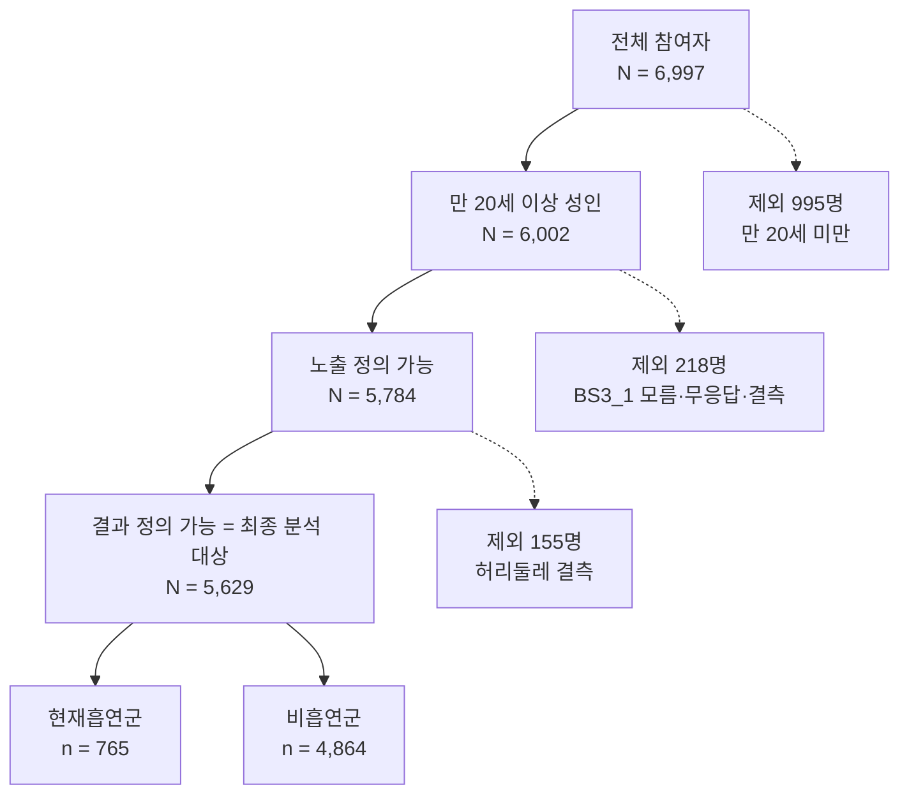

# 10주차: 분석 대상 선정과 Table 1 (4팀: 현재흡연 → 복부비만)

모든 숫자는 `code/10_table1.ipynb`의 출력에서 가져왔다. 자료: 2024년 국민건강영양조사 (제9기 3차년도) `HN24_ALL.sav`.

**9주차 대비 달라진 점:** 9주차 문서에는 단계별 인원이 `N = __`로 비어 있었고, 이번에 원시자료로 모두 확정했다. 또한 가중치를 `wt_itv`(자료에 없는 변수명)에서 `wt_itvex`로 바꾸고, 비흡연 판정을 `BS3_1` 3·8로 정리했다(`docs/09_protocol.md` 반영).

---

## B-1. 대상자 흐름도

| 단계 | 기준 | 남은 인원 | 빠진 인원 | 빠진 이유 |
| :-- | :-- | --: | --: | :-- |
| 1 | 2024년 국민건강영양조사 전체 참여자 | 6,997 | - | - |
| 2 | 만 20세 이상 성인 (`age` >= 20) | 6,002 | 995 | 만 20세 미만 |
| 3 | 노출(현재흡연) 정의 가능 (`BS3_1` 1·2·3·8) | 5,784 | 218 | `BS3_1` 9(모름·무응답) 216, 결측 2 |
| 4 | 결과(복부비만) 정의 가능 = 최종 분석 대상 (`HE_wc` 있음) | 5,629 | 155 | 허리둘레 결측 |

최종: 현재흡연군 765명, 비흡연군 4,864명

* 행을 지우지 않고 분석 대상 표시변수 `in_analysis = 1`(만 20세 이상이면서 노출과 결과를 정의할 수 있는 사람)을 만들어 도메인으로 다룬다. 층·집락 구조가 유지되므로 설계 기반 SE를 구할 수 있다.
* 공변량 결측(소득·교육·신체활동)은 사람을 제외하지 않고 Table 1의 해당 행에 결측 수로 적었다.

---

## B-2. Table 1

| 변수 | 전체 | 현재흡연군 | 비흡연군 |
| :-- | --: | --: | --: |
| n (비가중) | 5,629 | 765 | 4,864 |
| 복부비만 (결과), n (가중 %) |  |  |  |
| 　복부비만 | 2,026 (35.5) | 306 (40.3) | 1,720 (34.6) |
| 허리둘레, cm, 평균 (SE) | 84.0 (0.21) | 87.4 (0.42) | 83.4 (0.21) |
| 나이, 세, 평균 (SE) | 49.8 (0.47) | 47.2 (0.69) | 50.3 (0.50) |
| 성별, n (가중 %) |  |  |  |
| 　남 | 2,410 (50.0) | 636 (87.3) | 1,774 (42.9) |
| 　여 | 3,219 (50.0) | 129 (12.7) | 3,090 (57.1) |
| 소득 4분위수, n (가중 %) |  |  |  |
| 　1 | 1,383 (24.2) | 234 (28.1) | 1,149 (23.5) |
| 　2 | 1,407 (25.1) | 191 (26.7) | 1,216 (24.8) |
| 　3 | 1,413 (25.4) | 177 (24.3) | 1,236 (25.6) |
| 　4 | 1,410 (25.3) | 161 (20.9) | 1,249 (26.1) |
| 　결측, n | 16 | 2 | 14 |
| 교육수준, n (가중 %) |  |  |  |
| 　1 | 934 (11.5) | 67 (5.8) | 867 (12.6) |
| 　2 | 584 (8.1) | 87 (9.0) | 497 (7.9) |
| 　3 | 1,845 (34.0) | 325 (42.9) | 1,520 (32.3) |
| 　4 | 2,260 (46.5) | 284 (42.4) | 1,976 (47.2) |
| 　결측, n | 6 | 2 | 4 |
| 음주 (최근 1년), n (가중 %) |  |  |  |
| 　비음주 | 1,648 (24.7) | 106 (11.1) | 1,542 (27.3) |
| 　음주 | 3,981 (75.3) | 659 (88.9) | 3,322 (72.7) |
| 유산소 신체활동, n (가중 %) |  |  |  |
| 　미실천 | 2,962 (52.7) | 414 (53.3) | 2,548 (52.6) |
| 　실천 | 2,313 (47.3) | 306 (46.7) | 2,007 (47.4) |
| 　결측, n | 354 | 45 | 309 |

**각주**
* a. n은 비가중 관측 수이고, %와 평균은 가중 추정치이다. 범주형은 n (가중 %), 연속형은 가중 평균 (SE)이다. 결측은 비가중 n이며, 가중 %는 결측을 제외한 응답자 기준이라 범주별 합이 100%이다.
* b. 연속형 변수는 히스토그램과 왜도로 요약통계를 정했다. 분석 대상에서 나이의 왜도는 -0.27, 허리둘레의 왜도는 0.34로 모두 절댓값이 1보다 작고 한쪽으로 크게 치우치지 않아 가중 평균 (SE)을 사용했다.
* c. 가중치는 `wt_itvex`(건강설문·검진조사 가중치), 층은 `kstrata`(27개 층), 집락은 `psu`(192개 집락)이다. 분석 대상 표시변수(`in_analysis`)와 집단 지시변수를 도메인으로 사용했고, 설계 기반 SE는 테일러 선형화로 구했다.
* d. 비해당·무응답·결측 처리: `BS3_1`=8(비해당, 평생 비흡연)은 비흡연으로 분류했고, `BS3_1`=9(모름·무응답)와 결측은 노출을 정의할 수 없어 분석 대상에서 제외했다. `BD1_11`=8(비해당, 평생 마신 적 없음)은 비음주로 분류했다. 소득·교육·신체활동의 결측은 사람을 제외하지 않고 해당 행의 분모에서만 제외했다. 분석 대상에서 결측 비율이 가장 큰 변수는 신체활동(354명, 6.3%)이며 10%를 넘는 변수는 없다.
* e. 자료: 질병관리청 국민건강영양조사 2024년(제9기 3차년도) 원시자료.
* 소득·교육의 범주 1~4는 원 코드이며 각 코드의 뜻은 이용지침서에서 확인해 정의표에 적는다.

**읽을 때 주의:** 현재흡연군은 남성이 87.3%로 비흡연군(42.9%)과 크게 다르다. 현재흡연군과 비흡연군의 복부비만 유병률 차이는 횡단면에서 관찰된 연관성이며 인과 효과를 의미하지 않는다. 연령·성별·음주·신체활동 등 교란 가능성은 11주차 DAG에서 판단하며, Table 1만으로 교란변수를 확정하지 않는다.

---

## B-3. 비가중 대 가중 비교

### 비가중 표 (Table 1과 같은 형식)

| 변수 | 전체 | 현재흡연군 | 비흡연군 |
| :-- | --: | --: | --: |
| n (비가중) | 5,629 | 765 | 4,864 |
| 복부비만 (결과), n (비가중 %) |  |  |  |
| 　복부비만 | 2,026 (36.0) | 306 (40.0) | 1,720 (35.4) |
| 허리둘레, cm, 평균 (SD) | 83.8 (11.23) | 87.0 (10.59) | 83.3 (11.24) |
| 나이, 세, 평균 (SD) | 54.0 (16.95) | 50.5 (14.79) | 54.5 (17.20) |
| 성별, n (비가중 %) |  |  |  |
| 　남 | 2,410 (42.8) | 636 (83.1) | 1,774 (36.5) |
| 　여 | 3,219 (57.2) | 129 (16.9) | 3,090 (63.5) |
| 소득 4분위수, n (비가중 %) |  |  |  |
| 　1 | 1,383 (24.6) | 234 (30.7) | 1,149 (23.7) |
| 　2 | 1,407 (25.1) | 191 (25.0) | 1,216 (25.1) |
| 　3 | 1,413 (25.2) | 177 (23.2) | 1,236 (25.5) |
| 　4 | 1,410 (25.1) | 161 (21.1) | 1,249 (25.8) |
| 　결측, n | 16 | 2 | 14 |
| 교육수준, n (비가중 %) |  |  |  |
| 　1 | 934 (16.6) | 67 (8.8) | 867 (17.8) |
| 　2 | 584 (10.4) | 87 (11.4) | 497 (10.2) |
| 　3 | 1,845 (32.8) | 325 (42.6) | 1,520 (31.3) |
| 　4 | 2,260 (40.2) | 284 (37.2) | 1,976 (40.7) |
| 　결측, n | 6 | 2 | 4 |
| 음주 (최근 1년), n (비가중 %) |  |  |  |
| 　비음주 | 1,648 (29.3) | 106 (13.9) | 1,542 (31.7) |
| 　음주 | 3,981 (70.7) | 659 (86.1) | 3,322 (68.3) |
| 유산소 신체활동, n (비가중 %) |  |  |  |
| 　미실천 | 2,962 (56.2) | 414 (57.5) | 2,548 (55.9) |
| 　실천 | 2,313 (43.8) | 306 (42.5) | 2,007 (44.1) |
| 　결측, n | 354 | 45 | 309 |

### 비교 기준
* 분석 대상 전체(`전체` 열)에서 비교했다. 범주형은 가중 % − 비가중 %(%p), 연속형은 (가중 평균 − 비가중 평균) / 비가중 SD(표준화 차이)이다.
* 변수를 고르는 점수는 범주형은 변수 안에서 가장 큰 |%p|, 연속형은 |표준화 차이| × 100이다.

### 차이가 큰 변수 3개

| 변수 | 범주/통계 | 비가중 | 가중 | 차이(%p 또는 평균 차이) | 순위 기준 점수 |
| :-- | :-- | :-- | :-- | :-- | :-- |
| 나이 | 평균 | 53.97 | 49.81 | -4.17 | 24.59 |
| 성별 | 여 | 57.19 | 50.02 | -7.16 | 7.16 |
| 교육 | 4 | 40.19 | 46.45 | 6.26 | 6.26 |

전체 비교표:

| 변수 | 범주/통계 | 비가중 | 가중 | 차이(%p 또는 평균 차이) | 순위 기준 점수 |
| :-- | :-- | :-- | :-- | :-- | :-- |
| 복부비만 | 복부비만 | 35.99 | 35.52 | -0.48 | 0.48 |
| 성별 | 남 | 42.81 | 49.98 | 7.16 | 7.16 |
| 성별 | 여 | 57.19 | 50.02 | -7.16 | 7.16 |
| 소득 | 1 | 24.64 | 24.24 | -0.4 | 0.4 |
| 소득 | 2 | 25.07 | 25.07 | 0.0 | 0.0 |
| 소득 | 3 | 25.17 | 25.42 | 0.25 | 0.25 |
| 소득 | 4 | 25.12 | 25.27 | 0.15 | 0.15 |
| 교육 | 1 | 16.61 | 11.51 | -5.1 | 5.1 |
| 교육 | 2 | 10.39 | 8.06 | -2.33 | 2.33 |
| 교육 | 3 | 32.81 | 33.98 | 1.17 | 1.17 |
| 교육 | 4 | 40.19 | 46.45 | 6.26 | 6.26 |
| 음주 | 비음주 | 29.28 | 24.7 | -4.58 | 4.58 |
| 음주 | 음주 | 70.72 | 75.3 | 4.58 | 4.58 |
| 신체활동 | 미실천 | 56.15 | 52.72 | -3.44 | 3.44 |
| 신체활동 | 실천 | 43.85 | 47.28 | 3.44 | 3.44 |
| 나이 | 평균 | 53.97 | 49.81 | -4.17 | 24.59 |
| 허리둘레 | 평균 | 83.77 | 84.03 | 0.27 | 2.39 |

### 차이가 나는 이유 (이용지침서 근거 필요)

데이터에서 확인한 사실: 가중하면 나이 평균이 4.2세 낮아지고(54.0 → 49.8), 여성 비율이 57.2%에서 50.0%로 줄며, 대졸 이상(교육 4) 비율이 40.2%에서 46.5%로 늘어난다. 즉 비가중 표에는 고령·여성·낮은 교육 수준의 사람이 많이 들어 있다.

⚠ **아래는 팀이 이용지침서에서 직접 채워야 한다.** 과제 지침은 추측이 아니라 출처를 밝히라고 요구하므로, 지침서의 표본설계 설명(p.__)과 가중치 산출 설명(p.__)에서 다음을 찾아 쓴다.
1. 어떤 집단이 표본에 많이 또는 적게 뽑혔는가 (표본설계, 층화·집락 추출)
2. 무응답 보정이 가중치에 어떻게 작용하는가 (p.__)
3. 사후층화가 어떤 기준(예: 성·연령별 인구)으로 가중치를 조정하는가 (p.__)

---

## 역할 분담
* **남경민:** `code/10_table1.ipynb` 구현 및 실행 확인, 비가중 표
* **봉수영:** 흐름도 확인, `docs/10_table1.md` 최종 검토 및 커밋, `docs/09_protocol.md` 수정본 커밋

