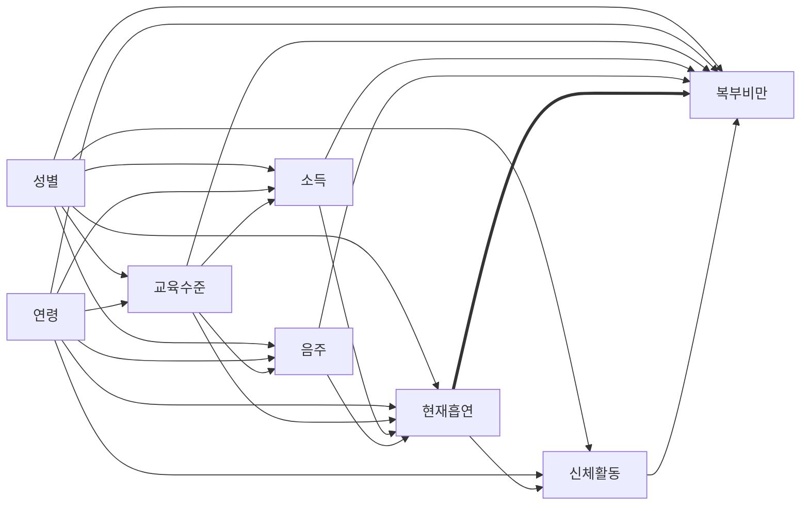

# 11주차 과제: DAG와 복합표본 회귀 (4팀: 현재흡연 → 복부비만)

* **자료:** 국민건강영양조사 제9기 3차년도(2024), `HN24_ALL.sav`
* **기준:** `docs/10_table1.md`의 분석 대상(`in_analysis = 1`, 5,629명)과 변수 정의를 그대로 사용한다.
* **연구질문:** 만 20세 이상 성인에서 현재흡연은 복부비만(남 ≥90cm, 여 ≥85cm)과 관련이 있는가?
* **추정 대상:** 현재흡연이 복부비만에 미치는 **총효과**(관련성)
* 모든 숫자는 `code/11_regression.ipynb`의 출력에서 가져왔다. ⚠️ `〔 〕`는 팀에서 직접 확인해 고칠 자리(AI 사용 내역의 검증 방법)이다.

---

## C-1. DAG와 보정집합

### 변수 정의 (Table 1과 동일)

| 구분 | 변수 | 정의 |
| :--- | :--- | :--- |
| 노출 | 현재흡연 | `BS3_1` = 1·2 → 현재흡연군, 3·8 → 비흡연군(과거흡연 포함) |
| 결과 | 복부비만 | 허리둘레 남 ≥90cm, 여 ≥85cm |
| 공변량 | 성별, 연령, 소득 4분위(개인), 교육수준, 최근 1년 음주, 유산소 신체활동 | Table 1과 동일 |

### DAG



굵은 화살표가 추정하려는 총효과이다. dagitty.net에는 아래 코드를 붙여 넣는다.

```
dag {
  smoke [exposure]
  abd [outcome]
  sex -> {smoke abd edu inc alc pa}
  age -> {smoke abd edu inc alc pa}
  edu -> {inc smoke abd alc}
  inc -> {smoke abd}
  alc -> {smoke abd}
  smoke -> {abd pa}
  pa -> abd
}
```

### 역할 표

| 공변량 | 역할 | 근거(한 줄) |
| :--- | :--- | :--- |
| 성별 | 교란 | 태어날 때 정해져 흡연보다 앞서고, 한국 성인에서 흡연율과 허리둘레 기준·체지방 분포가 모두 성별로 다르다(Table 1: 현재흡연군 87.3% 남성). |
| 연령 | 교란 | 흡연 시작·지속 양상(세대 차)과 연령에 따른 복부지방 증가에 모두 앞선다. |
| 교육수준 | 교란 | 성인 흡연은 대개 학업 중·후 형성되므로 시간상 앞서고, 교육수준은 흡연과 비만 모두와 관련된다. |
| 소득 | 교란 | 교육 → 소득 순서이며, 소득이 흡연과 식생활·비만 모두에 영향을 준다고 본다. |
| 최근 1년 음주 | 교란(애매) | 흡연과 음주는 함께 나타나는 생활습관이고 음주는 에너지 섭취·복부지방을 늘린다. 흡연 → 음주 방향도 가능해 애매하다. |
| 유산소 신체활동 | 매개(애매) | 흡연 → 운동 능력·실천 저하 → 복부비만 경로가 그럴듯해 매개로 본다. 반대로 활동이 흡연에 앞선다고 보면 교란이 된다. |

### 보정집합

* **모형 2(주 분석):** 성별, 연령, 소득, 교육수준, 음주. 신체활동은 매개로 보아 **보정하지 않는다**.
* 충돌부로 분류한 변수는 없다.
* 최소 보정집합 확인: 이 DAG에서 흡연 → 복부비만 총효과의 최소 보정집합은 **{성별, 연령, 교육수준, 소득, 음주}** 하나뿐이다(흡연의 자손인 신체활동은 제외). 이 결과는 파이썬(networkx)의 d-분리 검사로 확인했다. 제출 전에 위 코드를 dagitty.net에 넣어 같은 결과가 나오는지 캡처해 함께 붙인다.

### 애매한 변수 처리

* **음주:** 교란으로 정했다. 모형 2에 포함하고, 12주차에 음주를 빼고 다시 적합해 결과 변화를 본다.
* **신체활동:** 매개로 정했다. 모형 3에서 더해 변화를 보고, 12주차에 교란으로 본 보정 모형과 비교한다. 신체활동은 결측이 6.3%여서 모형 3은 완전 사례 인원이 줄어든다.

---

## C-2. Table 2 — 무보정·보정 회귀

**분석 인원 (노트북 3번 셀 출력)**

| 대상 | n | 현재흡연 | 비흡연 | Table 1 대비 제외 |
| :--- | ---: | ---: | ---: | ---: |
| Table 1 분석 대상 | 5,629 | 765 | 4,864 | - |
| 모형 1·2 (완전 사례) | 5,607 | 761 | 4,846 | 22 (소득·교육 결측) |
| 모형 3 (완전 사례) | 5,255 | 716 | 4,539 | 374 (소득·교육·신체활동 결측) |

**Table 2. 현재흡연과 복부비만의 관련성: 복합표본 로지스틱 회귀 (국민건강영양조사 제9기 3차년도, 2024)**

| 모형 | 분석 n | OR (95% CI) | p |
| :--- | ---: | :--- | ---: |
| 모형 1: 노출만 | 5,607 | 1.28 (1.09–1.51) | 0.003 |
| 모형 2: + 성별, 연령, 소득, 교육, 음주 | 5,607 | 1.02 (0.85–1.21) | 0.855 |
| 모형 3: 모형 2 + 신체활동 | 5,255 | 1.00 (0.84–1.19) | 0.978 |

현재흡연: 비흡연군(과거흡연 포함)이 기준 범주(OR = 1).

**각주**

a. 모형 1과 모형 2는 같은 사람(보정변수가 모두 있는 사람)으로 적합했다. 모형 3은 신체활동이 있는 사람으로 적합했다. 모형 3과 같은 사람(n = 5,255)에서의 모형 2 결과는 OR 1.02 (0.86–1.21), p = 0.831이다.

b. 이분형 결과에 대한 로지스틱 회귀이다. 가중치 `wt_itvex`, 층 `kstrata`, 집락 `psu`를 쓰고, 층·집락 선형화로 분산을 구했다. 신뢰구간은 t 분포(자유도 = 집락 수 − 층 수 = 192 − 27 = 165)를 썼다.

c. 도메인 분석: 행을 지우지 않고 `in_analysis` 밖의 사람과 결측 사례는 가중치 0으로 두었다.

d. 결측은 완전 사례 분석으로 처리했다(소득 결측 0.3%, 교육 0.1%, 신체활동 6.3%). 연령은 연속형(1세당), 80은 "80세 이상" 상한 코드이다. 소득·교육은 범주형이다.

e. 보정변수 계수는 표에 싣지 않았다. 자료: 국민건강영양조사 제9기 3차년도(2024).

---

## C-3. 결과 해석

* **결과:** 보정 전에는 현재흡연군이 비흡연군(과거흡연 포함)보다 복부비만일 오즈가 1.28배(95% CI 1.09–1.51)였다. 성별·연령·소득·교육·음주를 보정하면 OR 1.02(0.85–1.21)로, 이 자료에서는 현재흡연과 복부비만의 뚜렷한 관련성을 확인하지 못했다. 신뢰구간이 1을 가로지르지만 '관련이 없다'는 뜻은 아니며, 구간은 약 15% 감소에서 21% 증가까지의 값을 포함한다.
* **보정 전후:** OR이 1.28에서 1.02로 1에 가까워졌다(감소 방향). 변수를 하나씩 더해 본 보조 분석(노트북 6번 셀)에서 성별만 보정해도 OR이 0.98(0.83–1.16)로 내려갔고, 성별·연령을 함께 보정하면 1.03(0.87–1.23)이었다. 반면 연령만 보정하면 1.38로 오히려 커졌고, 소득·교육(1.33)이나 음주(1.32)만으로는 거의 바뀌지 않았다. 이는 DAG의 구조와 맞는다. 성별이 흡연(현재흡연군 87.3% 남성)과 복부비만(여성의 OR 0.48) 모두의 원인이어서 가장 큰 교란이고, 현재흡연군이 더 젊어(평균 47.2세 대 50.3세) 연령은 반대 방향으로 작용한다. 두 효과를 함께 보정하면 크기가 크게 줄어든다. 신체활동(매개로 본 변수)을 더한 모형 3은 OR 1.00(0.84–1.19)으로 모형 2와 거의 같아, 이 자료에서는 신체활동을 거치는 경로가 크지 않았다. 모형 3은 인원이 달라 같은 사람의 모형 2(1.02)와 비교했다.
* **크기 해석 주의:** 복부비만이 흔하므로(가중 35.5%) 오즈비는 위험비보다 크게 보인다. 유병률비는 12주차에 다룬다.
* **한계:** 한 시점 자료라 역방향 인과(체중 증가와 흡연 지속)를 구분할 수 없다. 흡연·음주·신체활동은 자기 기입이라 오차가 있고, 식사량·유전·스트레스 등 측정되지 않은 교란이 남는다. 비흡연군에 과거흡연자가 포함된다. DAG의 화살표 방향은 자료로 확인할 수 없다.
* **12주차 계획:** (1) 음주를 빼고 넣은 비교, 신체활동을 교란으로 본 보정 비교 (2) 현재흡연 정의를 지침서 공식 정의(평생 100개비 이상 + 현재 흡연)로 바꾼 민감도분석 (3) 유병률비 추정.

---

## 역할 분담
* **남경민:** `code/11_regression.ipynb` 구현·실행
* **봉수영:** `docs/11_regression.md` 작성·검토, 커밋

## AI 사용 내역
* **사용 도구:** Claude
* **사용 목적:** DAG 초안, 문서 틀, 설계 기반 로지스틱 회귀 코드 작성 보조
* **검증 방법:** 원시자료 `hn24.sav`로 노트북을 처음부터 실행해 문서의 모든 숫자(인원, OR, 95% CI, p, 자유도)를 출력과 대조했고, 노트북 앞부분(1–3번 셀)은 10주차 노트북의 셀을 그대로 가져와 Table 1 분석 대상(5,629명)이 같은지 확인했다. 〔팀원이 Colab에서 다시 실행해 확인한 뒤 이 문장을 맞게 고치기〕
