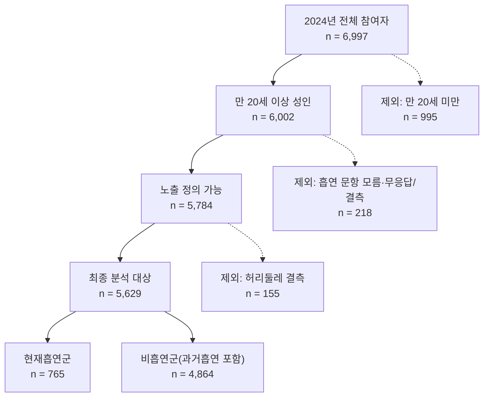

# 현재흡연과 복부비만의 관련성: 2024년 국민건강영양조사 성인 자료의 복합표본 분석

4팀 (남경민, 봉수영) · 13주차 보고서 초안

---

## 초록

**목적:** 한국 성인에서 현재흡연과 복부비만의 관련성을 알아보았다. **방법:** 2024년 국민건강영양조사 만 20세 이상 5,629명(현재흡연 765명)을 대상으로 층·집락·가중치를 반영한 복합표본 로지스틱 회귀를 했고, 성별·연령·소득·교육·음주를 보정했다. **결과:** 보정 전 오즈비는 1.28(95% CI 1.09–1.51)이었고, 보정 후 오즈비는 1.02(0.85–1.21), 유병률비는 1.02(0.92–1.12)였다. 성별만 보정해도 0.98(0.83–1.16)이었다. **결론:** 이 자료에서는 보정 후 뚜렷한 관련성을 확인하지 못했다.

**주요 단어:** 현재흡연, 복부비만, 국민건강영양조사, 복합표본, 오즈비, 유병률비

---

## 1. 서론

복부비만은 허리둘레로 평가하는 체지방 분포의 지표이다. 선행연구에서는 흡연자가 체질량지수는 낮아도 복부지방 비율은 높다고 보고했다(Chiolero 등, 2008; Shimokata 등, 1989). 따라서 현재흡연이 복부비만과 관련이 있는지 확인하는 것은 의미가 있다.

한국 성인에서는 현재흡연자 중 남성의 비율이 매우 높다. 이 연구의 자료에서도 현재흡연군의 87.3%가 남성이다(Table 1). 복부비만 기준(남 ≥90cm, 여 ≥85cm)과 체지방 분포가 성별로 다르므로, 성별 구성이 흡연과 복부비만의 관련성을 다르게 보이게 할 수 있다. 연령, 소득, 교육수준, 음주도 흡연과 허리둘레 모두와 관련될 수 있다.

이 연구의 목적은 만 20세 이상 한국 성인에서 현재흡연과 복부비만의 관련성을 복합표본 설계를 반영해 추정하고, 보정변수를 방향성 비순환 그래프(DAG)로 정해 결과가 보정에 따라 어떻게 달라지는지 확인하는 것이다. 한 시점의 자료이므로 인과 관계는 추정하지 않고 관련성만 다룬다.

---

## 2. 방법

### 2.1 자료와 연구 설계
국민건강영양조사 제9기 3차년도(2024) 원시자료(6,997명)를 썼다. 이 조사는 조사구와 가구를 추출단위로 하는 층화집락추출이며, 층(`kstrata`) 27개와 집락(`psu`) 192개로 이루어져 있다. 노출과 공변량은 건강설문조사, 결과는 검진조사 변수이므로 이 둘을 함께 쓸 때의 가중치 `wt_itvex`(건강설문-검진조사 가중치)를 썼다.

### 2.2 분석 대상
만 20세 이상이면서 흡연 문항(`BS3_1`)에 응답하고 허리둘레(`HE_wc`)가 있는 5,629명이다(Figure 1). 행을 지우지 않고 분석 대상 표시변수(`in_analysis = 1`)를 만들어 도메인 분석을 했다.

### 2.3 변수 정의
* **노출(현재흡연):** `BS3_1` = 1(매일피움)·2(가끔피움)을 현재흡연군, 3(과거흡연)·8(비해당, 평생 비흡연)을 비흡연군으로 했다. 비흡연군에는 과거흡연자가 포함된다.
* **결과(복부비만):** 허리둘레 남성 ≥90cm, 여성 ≥85cm(대한비만학회 기준, Kim 등, 2023).
* **공변량:** 성별, 연령(연속형, 80은 "80세 이상" 상한 코드), 소득 4분위(개인), 교육수준(4범주), 최근 1년 음주(`BD1_11` 2–6), 유산소 신체활동 실천.

### 2.4 보정변수 선택
교란·매개·충돌부의 구분은 DAG로 정했다. 성별, 연령, 교육수준, 소득, 음주를 교란으로 보아 주 분석(모형 2)에서 보정했다. 신체활동은 흡연 이후의 경로(흡연 → 신체활동 → 복부비만)에 있다고 보아 주 분석에서는 보정하지 않았다. 최소 보정집합은 {성별, 연령, 교육수준, 소득, 음주} 하나이다. 교육·소득·음주는 흡연과의 시간 순서가 확실하지 않고 신체활동의 역할도 애매하다. 자세한 근거는 11주차 문서(`docs/11_regression.md`)에 있다.

### 2.5 통계 분석
* **Table 1:** 비가중 n, 가중 %와 가중 평균(설계 기반 SE)으로 요약했다.
* **회귀:** 복부비만(0/1)에 대한 복합표본 로지스틱 회귀로 현재흡연의 오즈비(OR)와 95% 신뢰구간을 구했다. 층·집락 선형화로 분산을 구했고 신뢰구간은 t 분포(자유도 = 집락 수 − 층 수 = 192 − 27 = 165)를 썼다. 결측은 완전 사례 분석으로 처리했고, 분석 밖 사람과 결측 사례는 가중치 0으로 두었다.
* **모형:** 모형 1은 노출만, 모형 2는 성별·연령·소득·교육·음주를 보정했고(주 분석), 모형 3은 모형 2에 신체활동을 더했다. 보정변수를 하나씩 더했을 때의 변화도 보았다.
* **민감도분석(한 번에 가정 하나만 변경):** (S1) 신체활동을 교란으로 보아 모형 2에 더한다. (S-유병률) 복부비만이 흔해(가중 35.5%) 같은 보정변수로 포아송 회귀(로그 연결)를 적합해 유병률비(PR)를 구한다. (S2) 현재흡연을 지침서 공식 정의(평생 5갑 이상 피웠고 현재 피움)로 바꾼다.
* **구현:** 설계 기반 로지스틱·포아송 회귀는 Python(numpy, pandas, scipy)으로 직접 구현했다(`code/11_regression.ipynb`, `code/12_sensitivity.ipynb`).

---

## 3. 결과

모든 숫자는 각 표 아래에 적은 노트북의 출력이다.

### 3.1 대상자 흐름도

**Figure 1. 분석 대상 선정** (출처: `code/10_table1.ipynb`)

회귀분석의 완전 사례는 모형 1·2에서 5,607명(현재흡연 761명), 모형 3에서 5,255명(현재흡연 716명)이었다. 소득·교육 결측 22명과 신체활동 결측이 추가로 제외되었다(출처: `code/11_regression.ipynb`).

### 3.2 대상자의 일반적 특성

**Table 1. 현재흡연 여부에 따른 2024년 성인의 일반적 특성**

| 변수 | 전체 (n = 5,629) | 현재흡연군 (n = 765) | 비흡연군(과거흡연 포함) (n = 4,864) |
| :--- | ---: | ---: | ---: |
| 복부비만 (남 ≥90cm, 여 ≥85cm) |  |  |  |
| 　예 | 2,026 (35.5) | 306 (40.3) | 1,720 (34.6) |
| 허리둘레, cm — 평균 (SE) | 84.0 (0.21) | 87.4 (0.42) | 83.4 (0.21) |
| 성별 |  |  |  |
| 　남자 | 2,410 (50.0) | 636 (87.3) | 1,774 (42.9) |
| 　여자 | 3,219 (50.0) | 129 (12.7) | 3,090 (57.1) |
| 연령, 세 (80은 '80세 이상') — 평균 (SE) | 49.8 (0.47) | 47.2 (0.69) | 50.3 (0.50) |
| 소득 4분위수(개인) |  |  |  |
| 　하 | 1,383 (24.2) | 234 (28.1) | 1,149 (23.5) |
| 　중하 | 1,407 (25.1) | 191 (26.7) | 1,216 (24.8) |
| 　중상 | 1,413 (25.4) | 177 (24.3) | 1,236 (25.6) |
| 　상 | 1,410 (25.3) | 161 (20.9) | 1,249 (26.1) |
| 　결측 | 16 | 2 | 14 |
| 교육수준 |  |  |  |
| 　초졸 이하 | 934 (11.5) | 67 (5.8) | 867 (12.6) |
| 　중졸 | 584 (8.1) | 87 (9.0) | 497 (7.9) |
| 　고졸 | 1,845 (34.0) | 325 (42.9) | 1,520 (32.3) |
| 　대졸 이상 | 2,260 (46.5) | 284 (42.4) | 1,976 (47.2) |
| 　결측 | 6 | 2 | 4 |
| 최근 1년 음주 |  |  |  |
| 　음주 | 3,981 (75.3) | 659 (88.9) | 3,322 (72.7) |
| 　비음주 | 1,648 (24.7) | 106 (11.1) | 1,542 (27.3) |
| 유산소 신체활동 실천 |  |  |  |
| 　실천 | 2,313 (47.3) | 306 (46.7) | 2,007 (47.4) |
| 　미실천 | 2,962 (52.7) | 414 (53.3) | 2,548 (52.6) |
| 　결측 | 354 | 45 | 309 |

n은 비가중 관측 수이고 %와 평균은 가중 추정치(설계 기반 SE)이다. 범주별 %는 결측을 뺀 응답자 기준이며 반올림 때문에 합이 100%가 아닐 수 있다. 연령 80은 상한 코드이다. 출처: `code/10_table1.ipynb`.

현재흡연군은 비흡연군보다 남성이 많았고(87.3% 대 42.9%), 평균 연령이 낮았으며(47.2세 대 50.3세), 최근 1년 음주 비율이 높았다(88.9% 대 72.7%). 복부비만 가중 유병률은 현재흡연군 40.3%, 비흡연군 34.6%였다.

### 3.3 현재흡연과 복부비만의 관련성

**Table 2. 현재흡연과 복부비만의 관련성: 복합표본 로지스틱 회귀**

| 모형 | 분석 n | OR (95% CI) | p |
| :--- | ---: | :--- | ---: |
| 모형 1: 노출만 | 5,607 | 1.28 (1.09–1.51) | 0.003 |
| 모형 2: + 성별, 연령, 소득, 교육, 음주 | 5,607 | 1.02 (0.85–1.21) | 0.855 |
| 모형 3: 모형 2 + 신체활동 | 5,255 | 1.00 (0.84–1.19) | 0.978 |

비흡연군(과거흡연 포함)이 기준 범주(OR = 1). 모형 3과 같은 사람(n = 5,255)에서의 모형 2는 OR 1.02 (0.86–1.21), p = 0.831이다. 출처: `code/11_regression.ipynb`.

**Table 2-보조. 보정변수를 하나씩 더했을 때의 OR (모형 1·2와 같은 5,607명)**

| 보정 | OR (95% CI) |
| :--- | :--- |
| 노출만 | 1.28 (1.09–1.51) |
| + 성별 | 0.98 (0.83–1.16) |
| + 연령 | 1.38 (1.17–1.63) |
| + 성별·연령 | 1.03 (0.87–1.23) |
| + 소득·교육 | 1.33 (1.13–1.57) |
| + 음주 | 1.32 (1.13–1.55) |
| + 성별·연령·소득·교육·음주 (모형 2) | 1.02 (0.85–1.21) |

각 행은 노출만 있는 모형에 표시된 변수만 더한 결과이며 마지막 행만 모두 더한 모형이다. 출처: `code/11_regression.ipynb`.

보정 전에는 현재흡연군의 복부비만 오즈가 비흡연군의 1.28배였다(95% CI 1.09–1.51). 성별만 보정하면 OR이 0.98(0.83–1.16)로 낮아졌고, 연령만 보정하면 1.38(1.17–1.63)로 높아졌다. 성별과 연령을 함께 보정하면 1.03(0.87–1.23)이었다. 모든 보정변수를 넣은 모형 2의 OR은 1.02(0.85–1.21)로 신뢰구간이 1을 포함했다. 신체활동을 더한 모형 3의 OR은 1.00(0.84–1.19)이었다.

### 3.4 민감도분석

**Table 3. 민감도분석: 현재흡연과 복부비만의 관련성**

| 분석 | 측도 | 분석 n (현재흡연/기준) | 추정값 (95% CI) | p | 주 분석과의 차이 |
| :--- | :---: | ---: | :--- | ---: | :--- |
| 주 분석 (모형 2) | OR | 5,607 (761/4,846) | 1.02 (0.85–1.21) | 0.855 | - |
| S1: 모형 2 + 신체활동 | OR | 5,255 (716/4,539) | 1.00 (0.84–1.19) | 0.978 | 같은 사람의 모형 2 대비 ×0.98 |
| (같은 사람의 모형 2) | OR | 5,255 (716/4,539) | 1.02 (0.86–1.21) | 0.831 | 주 분석 대비 ×1.00 |
| S-유병률: 포아송 회귀 | PR | 5,607 (761/4,846) | 1.02 (0.92–1.12) | 0.746 | 주 분석 OR 대비 ×1.00 |
| S2: 공식 흡연 정의 | OR | 5,607 (754/4,853) | 1.02 (0.86–1.22) | 0.795 | 주 분석 대비 ×1.01 |

비흡연군(과거흡연 포함)이 기준 범주. S2에서는 평생 5갑 미만이면서 현재 피우는 7명이 비흡연 쪽으로 이동했다(현재흡연 765명 → 758명). '차이'는 추정값 ÷ 비교 기준 추정값이다. 모든 분석에서 자유도는 165이다. 출처: `code/12_sensitivity.ipynb`.

세 민감도분석의 추정값은 모두 1.00–1.02였고 신뢰구간은 모두 1을 포함했다.

---

## 4. 고찰

### 4.1 주요 결과
보정 전에는 현재흡연과 복부비만이 관련이 있어 보였다(OR 1.28, 95% CI 1.09–1.51). 그러나 성별·연령·소득·교육·음주를 보정하면 OR 1.02(0.85–1.21), 유병률비 1.02(0.92–1.12)로 이 자료에서는 뚜렷한 관련성을 확인하지 못했다. 신체활동을 보정에 넣거나 현재흡연을 공식 정의로 바꿔도 같았다.

### 4.2 가능한 설명
* **성별 구성:** 현재흡연군의 87.3%가 남성이고 비흡연군은 42.9%이다. 성별만 보정해도 OR이 1.28에서 0.98로 낮아졌으므로, 보정 전 관련성은 주로 성별 구성의 차이와 함께 나타난 것으로 볼 수 있다. 복부비만 기준과 체지방 분포가 남녀에서 다르다는 점과도 맞는다. 다만 현재흡연 여성은 129명으로 적어 성별로 나눈 분석은 하지 못했다.
* **연령:** 현재흡연군이 더 젊고(47.2세 대 50.3세) 연령이 높을수록 복부비만 오즈가 높으므로(1세당 OR 1.016, 11주차 노트북 출력), 연령만 보정하면 OR이 1.38로 커졌다. 성별과 연령은 서로 반대 방향으로 나타나 함께 보정해야 했다.
* **신체활동과 정의:** 신체활동을 더해도, 흡연 정의를 바꿔도 거의 달라지지 않았다. 이 자료에서는 신체활동을 지나는 경로나 평생 5갑 기준의 차이(7명)가 결과를 크게 바꾸지 않았다.
* **선행연구와의 차이:** 선행연구에서 흡연자의 복부지방이 많다고 보고한 것과 이 연구의 보정 후 결과는 일치하지 않는다. 이 연구는 복부지방을 직접 재지 않고 허리둘레를 이분형으로 나누었으며, 비흡연군에 과거흡연자가 섞여 있고 연구 대상과 설계가 달라 직접 비교하기는 어렵다.
* **정밀도:** 신뢰구간(0.85–1.21)은 약 15% 감소에서 21% 증가까지를 포함한다. '관련이 없다'가 아니라 '이 자료에서는 확인하지 못했다'로 해석해야 한다.

### 4.3 강점과 한계
**강점:** 대표성 있는 복합표본 자료이고 층·집락·가중치를 모두 반영했다. DAG로 보정변수를 정했고, 주 분석을 미리 정한 뒤 민감도분석 세 가지(신체활동의 역할, 측도, 흡연 정의)를 모두 보고했다.

**한계:**
* **자기 기입 흡연:** 흡연·음주·신체활동은 자기 기입이라 측정 오차가 있을 수 있다.
* **전자담배:** 전자담배 사용은 반영하지 않았다. 전자담배만 쓰는 사람은 비흡연군에 들어가며, 전자담배를 포함한 민감도분석(S3)은 하지 않았다.
* **역방향 인과:** 횡단자료라 복부비만이 먼저 있고 이후 흡연 행동이 달라지는 경우(예: 복부비만 → 금연 시도)와 흡연이 복부비만보다 앞서는 경우를 구분할 수 없다. 교육·소득·음주도 흡연과의 시간 순서가 확실하지 않다.
* **측정되지 않은 교란:** 식사량, 유전, 스트레스 등은 보정하지 못했다.
* **비흡연군 구성:** 과거흡연자가 비흡연군에 포함된다.
* **결측:** 완전 사례 분석이며(소득·교육 22명, 신체활동 추가 제외), 신체활동 결측은 6.3%이다.
* **DAG 가정:** 화살표 방향은 자료로 확인한 것이 아니라 이론적 판단이다.

### 4.4 결론
2024년 한국 성인 자료에서 현재흡연과 복부비만의 관련성은 보정 전 OR 1.28이었으나 성별·연령 등을 보정한 뒤에는 OR 1.02(0.85–1.21)로 뚜렷하지 않았다. 이 결과는 인과 관계를 뜻하지 않으며, 작은 관련성의 존재를 배제하지 못한다.

---

## 참고문헌

* Chiolero A, Faeh D, Paccaud F, Cornuz J. Consequences of smoking for body weight, body fat distribution, and insulin resistance. Am J Clin Nutr. 2008;87(4):801–809.
* Shimokata H, Muller DC, Andres R. Studies in the distribution of body fat. III. Effects of cigarette smoking. JAMA. 1989;261(8):1169–1173.
* 질병관리청. 국민건강영양조사 제9기(2022-2024) 원시자료 이용지침서. 2026.
* Kim KK, Haam JH, Kim BT, et al. Evaluation and Treatment of Obesity and Its Comorbidities: 2022 Update of Clinical Practice Guidelines for Obesity by the Korean Society for the Study of Obesity. J Obes Metab Syndr. 2023;32(1):1–24.

---

## E-2. 보고 점검표

| 점검 항목 | 보고서에 작성한 위치 | 충족 여부 | 14주차 보완 계획 |
| :--- | :--- | :---: | :--- |
| 연구 설계와 자료(자료원, 조사 연도, 표본설계, 가중치) | 2.1 자료와 연구 설계 | 충족 | 없음 |
| 대상 선정과 흐름도(단계별 인원, 제외 이유) | 2.2 분석 대상, 3.1 대상자 흐름도(Figure 1) | 충족 | 없음 |
| 노출·결과·공변량 정의와 보정변수 선택 근거 | 2.3 변수 정의, 2.4 보정변수 선택 | 충족 | 교육·소득·음주의 시간 순서가 애매한 점을 발표에서 보충 설명 |
| 통계 방법(복합표본 설계 반영, 결측 처리, 모형) | 2.5 통계 분석 | 충족 | 없음 |
| 주요 결과(Table 1–2, 효과 크기와 95% 신뢰구간) | 3.2 일반적 특성(Table 1), 3.3 관련성(Table 2) | 충족 | 없음 |
| 민감도분석(바꾼 가정, 결과 비교) | 3.4 민감도분석(Table 3), 4.2 가능한 설명 | 부분 충족 | 전자담배를 포함한 정의(S3)는 하지 않아 14주차에 추가 여부를 정해 보완 |
| 한계와 해석(관련성 표현, 인과 해석 주의) | 4.3 강점과 한계, 4.4 결론 | 부분 충족 | 현재흡연 여성이 129명이라 성별로 나눈 분석을 하지 못함. 성별 구성 때문에 생기는 한계를 발표 자료에 보충 |

---

## E-3. 발표 개요 (14주차 슬라이드 1–8장)

| 슬라이드 | 제목 | 들어갈 내용 (한 줄) |
| :---: | :--- | :--- |
| 1 | 현재흡연과 복부비만의 관련성 | 발표 제목, 팀명(4팀), 발표자(남경민, 봉수영), 자료(국민건강영양조사 제9기 3차년도, 2024) |
| 2 | 배경과 연구질문 | 선행연구에서 흡연자는 체질량지수가 낮아도 복부지방이 많다는 보고가 있어, 만 20세 이상 성인에서 현재흡연과 복부비만(남 ≥90cm, 여 ≥85cm)의 관련성을 확인한다 |
| 3 | 자료와 분석 대상 | 6,997명에서 만 20세 이상·흡연 문항 응답·허리둘레 있는 5,629명(현재흡연 765, 비흡연 4,864)을 선정했고, 현재흡연군은 87.3%가 남성이다 (Figure 1, Table 1) |
| 4 | 변수 정의와 보정변수 선택 | 현재흡연(`BS3_1` 1·2)과 복부비만을 정의하고, DAG로 성별·연령·소득·교육·음주를 교란으로 보정하며 신체활동은 매개로 보아 주 분석에서 뺀다 |
| 5 | 분석 방법 | 층·집락·가중치(`wt_itvex`)를 반영한 복합표본 로지스틱 회귀로 OR를 구하고, 모형 1(노출만)·2(보정)·3(신체활동 추가)과 민감도분석 세 가지를 비교한다 |
| 6 | 주 분석 결과: 보정 전후 | 현재흡연의 OR이 보정 전 1.28(1.09–1.51)에서 보정 후 1.02(0.85–1.21)로 변했고, 성별만 보정해도 0.98이다 (Table 2, Table 2-보조) |
| 7 | 민감도분석: 결론은 유지되는가 | 신체활동 보정(1.00), 유병률비(1.02), 공식 흡연 정의(1.02)에서도 신뢰구간이 1을 포함하는 같은 결과이다 (Table 3) |
| 8 | 해석, 한계, 결론 | 이 자료에서는 뚜렷한 관련성을 확인하지 못했으며 작은 관련성은 배제할 수 없다. 자기 기입 흡연, 전자담배 미반영, 역방향 인과가 한계이다 |

---

## 역할 분담
* **남경민:** 노트북(`10_table1`, `11_regression`, `12_sensitivity`) 실행·결과 확인, Table 1–3 숫자 대조
* **봉수영:** `docs/13_draft.md` 작성·검토, 커밋

## AI 사용 내역
* **사용 도구:** Claude
* **사용 목적:** 10–12주차 문서와 노트북 출력을 바탕으로 보고서 초안(서론, 방법, 결과, 고찰), 보고 점검표, 발표 개요 작성 보조
* **검증 방법:** 보고서의 숫자를 표 아래에 적은 출처 노트북(`10_table1`, `11_regression`, `12_sensitivity`)의 출력과 대조했다. Colab에서 실행한 노트북 출력과 문서의 모든 숫자(인원, OR·PR, 95% CI, p)가 같음을 확인했다.
